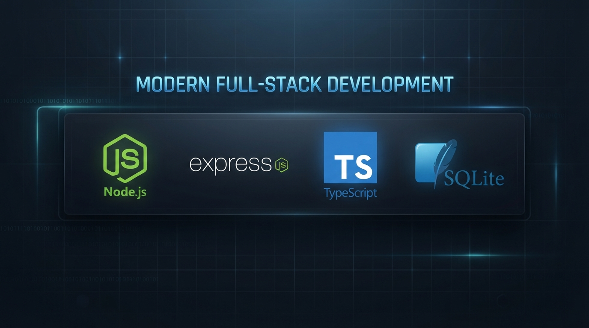

<p align="center">
  
</p>

# Snap

Acortador de URLs con analíticas, construido con **Node.js**, **Express 5**, **TypeScript** y **SQLite**.

Snap recibe una URL larga, genera un código corto aleatorio y redirige a la URL original cuando alguien visita ese código.

> **Estado:** en desarrollo. El acortado, la redirección y el listado ya funcionan. Los módulos `auth`, `dashboard` y `analytics` están planificados, pero todavía no tienen código.

---

## Tabla de contenidos

- [Características](#características)
- [Requisitos](#requisitos)
- [Puesta en marcha](#puesta-en-marcha)
- [Configuración](#configuración)
- [API](#api)
- [Arquitectura](#arquitectura)
- [Base de datos](#base-de-datos)
- [Tests](#tests)
- [Convenciones](#convenciones)
- [Añadir un módulo nuevo](#añadir-un-módulo-nuevo)

---

## Características

- **Códigos cortos impredecibles:** 7 caracteres base62 generados con `crypto.randomInt`. Hay unos 3,5 billones de combinaciones.
- **Colisiones controladas:** si un código ya existe, se reintenta con otro.
- **Validación de entrada:** solo se aceptan URLs `http` o `https` de hasta 2048 caracteres. Así se evita redirigir a `javascript:`, `data:`, `file:`, etc.
- **Redirección 302:** la respuesta no queda cacheada en el navegador, de modo que cada visita llega al servidor. Esto es necesario para las analíticas.
- **Sin dependencias de base de datos:** se usa el módulo `node:sqlite` que trae Node.
- **Configuración validada al arrancar:** si la configuración no es válida, el proceso no arranca.
- **Errores homogéneos:** todas las respuestas de error son JSON con la forma `{ error, message }`. En producción no se exponen detalles internos.
- **Logging de peticiones:** se registran método, ruta, status y duración. Nunca se registran el body, la query ni los headers.

## Requisitos

- **Node.js ≥ 22.18.** TypeScript se ejecuta directamente, sin compilar, y se usa `node:sqlite`.
- npm

> En algunas versiones de Node 22, `node:sqlite` muestra un `ExperimentalWarning` al arrancar. Es inofensivo.

## Puesta en marcha

```bash
npm install
npm run dev
```

El servidor queda escuchando en `http://localhost:3000` y se reinicia al cambiar el código. La base de datos `snap.db` se crea automáticamente en el directorio actual.

### Scripts

| Script | Descripción |
|---|---|
| `npm run dev` | Arranca en modo desarrollo con recarga automática (`node --watch`). |
| `npm run build` | Compila a JavaScript en `dist/`. Excluye los tests. |
| `npm start` | Ejecuta la versión compilada (`dist/server.js`). |
| `npm run typecheck` | Comprueba los tipos sin generar salida. |
| `npm test` | Ejecuta todos los tests una vez. |
| `npm run test:watch` | Ejecuta los tests en modo watch. |

### Producción

```bash
npm ci
npm run build
NODE_ENV=production DB_NAME=/var/lib/snap/snap.db PORT=8080 npm start
```

## Configuración

La configuración se lee de variables de entorno en [`src/config.ts`](src/config.ts) y se valida al importar el módulo. Si hay algún error, el proceso termina con un `ConfigError` que enumera todos los problemas.

| Variable | Por defecto | Descripción |
|---|---|---|
| `NODE_ENV` | `development` | `development`, `production` o `test`. |
| `PORT` | `3000` | Puerto HTTP. Debe ser un entero entre 1 y 65535. |
| `DB_NAME` | `snap.db` | Ruta del archivo SQLite. **Obligatoria en producción.** |

En `production`, los errores 500 no incluyen el mensaje interno. En `test`, el logger de peticiones está desactivado.

## API

Todas las respuestas son JSON, excepto la redirección.

### `POST /urls`: acortar una URL

```bash
curl -X POST http://localhost:3000/urls \
  -H 'content-type: application/json' \
  -d '{"url": "https://example.com/una/ruta/muy/larga"}'
```

**201 Created**

```json
{
  "code": "jPOgMYB",
  "url": "https://example.com/una/ruta/muy/larga",
  "createdAt": "2026-10-23T07:41:25.443Z",
  "shortUrl": "http://localhost:3000/jPOgMYB"
}
```

**400 Bad Request** si `url` falta, no es un string, no es una URL válida, no usa `http`/`https` o supera los 2048 caracteres:

```json
{ "error": "Bad Request", "message": "El campo \"url\" debe ser una URL http(s) válida" }
```

### `GET /urls`: listar URLs

Devuelve todas las URLs creadas, de la más reciente a la más antigua.

```json
[
  { "code": "jPOgMYB", "url": "https://example.com/una/ruta/muy/larga", "createdAt": "2026-10-23T07:41:25.443Z" }
]
```

### `GET /:code`: redirigir

| Caso | Respuesta |
|---|---|
| El código existe | `302 Found` con `Location: <url original>` |
| El código no existe | `404` `{ "error": "Not Found", "message": "El código abc1234 no existe" }` |

### `GET /health`: estado del servicio

```json
{ "status": "ok", "uptime": 12.34 }
```

### Errores

| Status | Cuándo |
|---|---|
| `400` | Body JSON malformado o datos de entrada inválidos. |
| `404` | Ruta o código inexistente. |
| `500` | Error inesperado. El mensaje solo se incluye fuera de producción. |

## Arquitectura

```
src/
├── server.ts                 # Punto de entrada: abre la BD y arranca el servidor
├── app.ts                    # createApp({ db }): monta middlewares y routers
├── config.ts                 # Carga y validación de variables de entorno
├── db/
│   └── database.ts           # createDatabase(path): conexión SQLite + esquema
├── middleware/
│   ├── errors.ts             # notFoundHandler y createErrorHandler
│   └── request-logger.ts     # createRequestLogger
├── modules/
│   ├── health/
│   │   └── health.routes.ts
│   ├── urls/
│   │   ├── urls.repository.ts  # Acceso a datos y generación de códigos
│   │   └── urls.routes.ts      # Validación HTTP, /urls y /:code
│   ├── auth/                 # (pendiente)
│   ├── dashboard/            # (pendiente)
│   └── analytics/            # (pendiente)
└── testing/
    └── listen.ts             # Utilidad para levantar la app en tests
```

### Principios

- **Un módulo por funcionalidad.** Cada carpeta de `src/modules/` agrupa sus rutas, su acceso a datos y sus tests.
- **La app no arranca el servidor.** `createApp()` solo construye la aplicación de Express y `server.ts` la pone a escuchar. Así los tests pueden levantar instancias aisladas en puertos libres.
- **Las dependencias se pasan como parámetros.** Las funciones `createX(...)` reciben lo que necesitan (la base de datos, el logger, opciones), en vez de leer estado global. En los tests se les pasa una base en memoria o funciones falsas.
- **Separación por capas:** el router se encarga de HTTP (validar, elegir el status, dar forma a la respuesta) y el repositorio se encarga de SQL. Las rutas nunca acceden a la base de datos directamente.

### Orden de la cadena de middlewares

```
request-logger → express.json() → /health → /urls → /:code → notFoundHandler → errorHandler
```

`GET /:code` captura cualquier ruta de un solo segmento, así que **cualquier router nuevo debe montarse antes que él**.

## Base de datos

SQLite mediante `node:sqlite` (`DatabaseSync`). Al abrir la conexión, `createDatabase()` crea el esquema de forma idempotente (`CREATE TABLE IF NOT EXISTS`).

```sql
CREATE TABLE urls (
  id           INTEGER PRIMARY KEY AUTOINCREMENT,
  code         TEXT    NOT NULL UNIQUE,
  original_url TEXT    NOT NULL,
  created_at   TEXT    NOT NULL   -- ISO 8601 (UTC)
);
```

Los archivos `*.db` están en `.gitignore`.

## Tests

```bash
npm test
```

Se usa [Vitest](https://vitest.dev/). Los tests están junto al código que prueban (`*.test.ts`) y son de dos tipos:

- **Unitarios:** por ejemplo, `urls.repository.test.ts`, contra una base SQLite en memoria (`':memory:'`).
- **HTTP de integración:** levantan la app real con `listen(createApp({ db }))` en un puerto aleatorio y le hacen peticiones con `fetch`.

Cada suite usa su propia base en memoria, así que no hay estado compartido ni archivos residuales.

## Convenciones

| Elemento | Convención | Ejemplo |
|---|---|---|
| Archivos | kebab-case, con sufijo de rol | `request-logger.ts`, `urls.routes.ts` |
| Tests | Junto al archivo que prueban | `urls.test.ts` |
| Funciones fábrica | `createX` | `createApp`, `createUrlsRouter` |
| Tipos e interfaces | PascalCase | `Config`, `UrlsRepository` |
| Constantes | UPPER_SNAKE_CASE | `CODE_LENGTH`, `MAX_ATTEMPTS` |
| Parámetros sin usar | Prefijo `_` | `(_req, res)` |

- Los imports relativos llevan la extensión `.ts`, y los tipos se importan con `import type`.
- Comentarios y mensajes en español.
- TypeScript en modo estricto con `erasableSyntaxOnly`, por lo que no se pueden usar `enum`, `namespace` ni parameter properties.

## Añadir un módulo nuevo

Para un módulo hipotético `foo`:

1. Si necesita tablas, añadir el esquema en `src/db/database.ts`.
2. Crear `src/modules/foo/foo.repository.ts` con `createFooRepository(db)`.
3. Crear `src/modules/foo/foo.routes.ts` con `createFooRouter(repository)`.
4. Montarlo en `src/app.ts` **antes** del router de redirección:
   ```ts
   app.use('/foo', createFooRouter(createFooRepository(db)));
   ```
5. Añadir `foo.repository.test.ts` y `foo.test.ts`, y ejecutar `npm test`.
